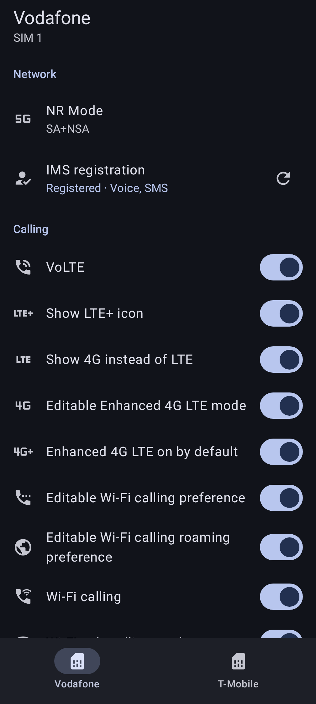
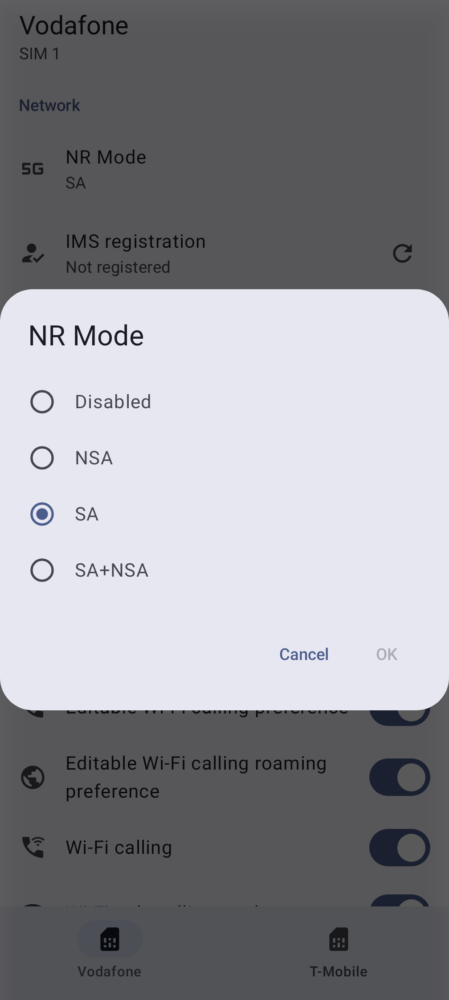
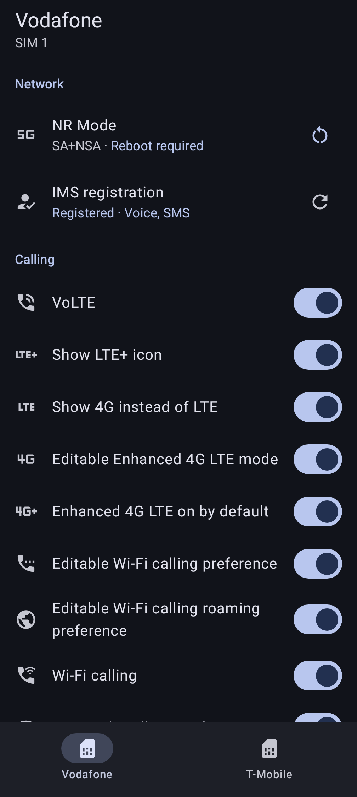

# Pixel 5G

Unlock the network features your Pixel hides in some countries.

In some countries, Pixel only allows 5G SA, and VoLTE or Wi-Fi calling are not available.  
With root access, this app changes the modem and carrier settings, separately for each SIM.

Or download the latest APK from the [Releases Section](https://github.com/SaeedDev94/pixel-5g/releases/latest).

  

## Features

**5G**
- Change the modem NR mode: SA, NSA, SA+NSA or disabled

**Calling**
- VoLTE, VoNR, Wi-Fi calling and video calling
- Enhanced 4G LTE mode options
- See the IMS registration status of each SIM
- Apply changes by restarting the phone service, no reboot needed

**Status bar**
- Show 4G instead of LTE
- Show the LTE+ icon

## Requirements

- Root access (Magisk or KernelSU)
- Pixel with Samsung modem (Pixel 6-9)
- Android 12 or newer

## How calling options work

Like the [Pixel IMS module](https://github.com/cxOrz/pixel_ims_module), the app adds its values to the carrier config of each SIM (`/data/user_de/0/com.android.phone/files/`), inside a `PIXEL_5G` block. Before the first change, a copy of the original file is saved next to it as `.bak`.

If the Pixel IMS module is installed, disable it to avoid conflicts.

> **Note:** VoNR can break mobile signal on carriers that don't support it. If you lose signal after enabling it, turn it off and restart the phone service.
